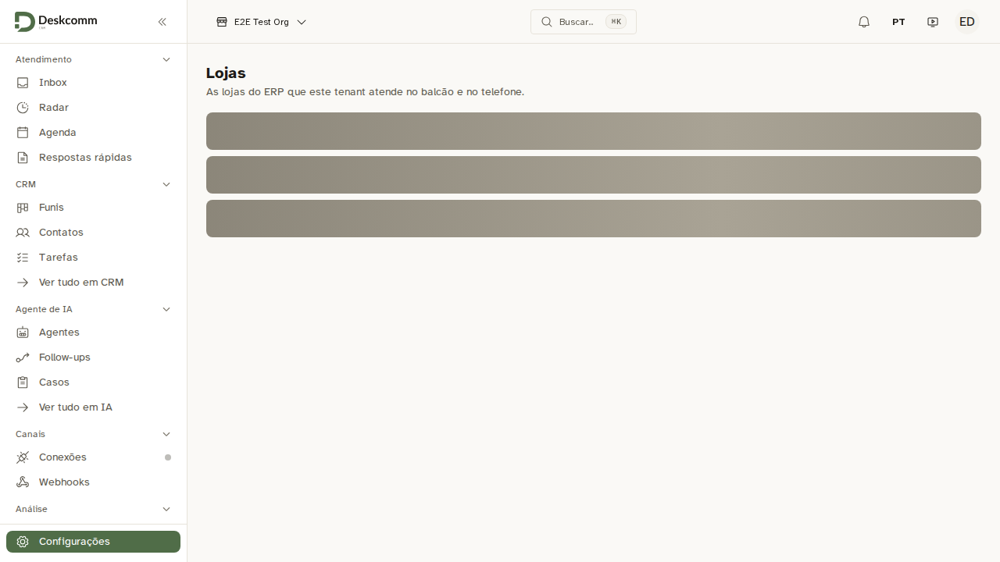
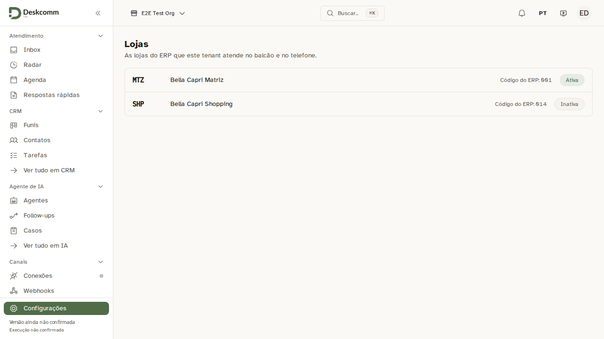
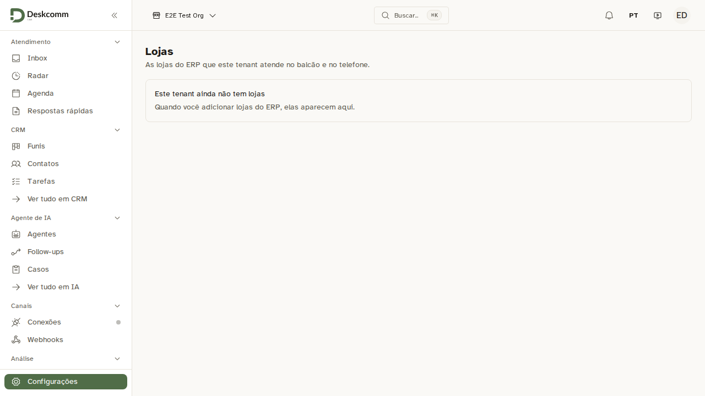
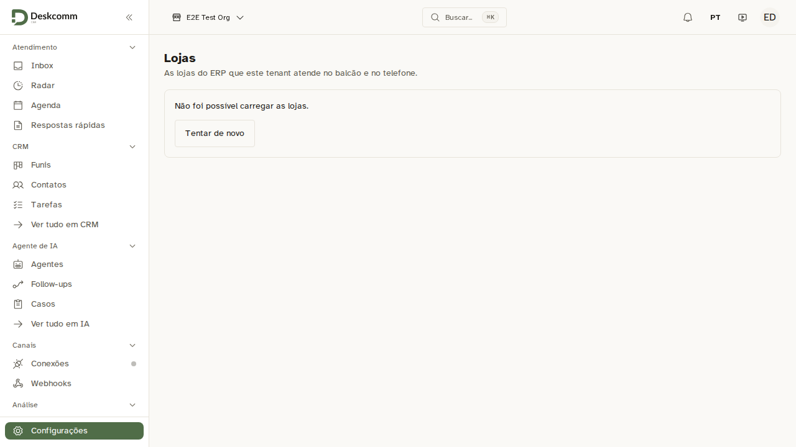
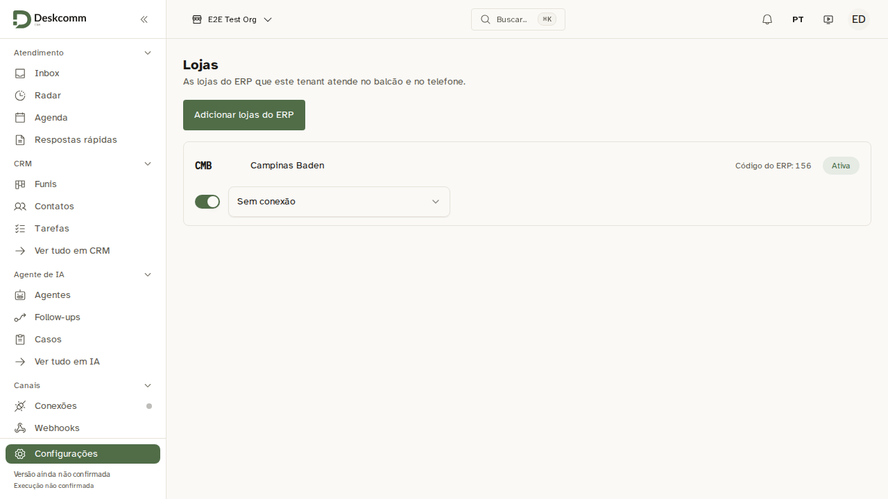

# US-007 - Aba Lojas: página, lista e estados

Prova pela tela de `tests/e2e/pdv-aba-lojas-lista.spec.ts` (build de produção, banco fresco do `baseline.sql`, módulo `pdv` instalado pelo dono em `/admin/modulos`, rotas `/api/v1/pdv/*` interceptadas). Alturas medidas com `getBoundingClientRect`: linhas de loja e botão "Tentar de novo" com 44 px ou mais.

Carregando (esqueleto):

Lista (sigla, nome, código do ERP, ativa/inativa):

Vazio:

ERP não configurado (orientação ao dono da instalação):

Erro com "Tentar de novo":

Contra o ERP real (homologação, só leitura; lojas da empresa, sem dado de pessoa):

