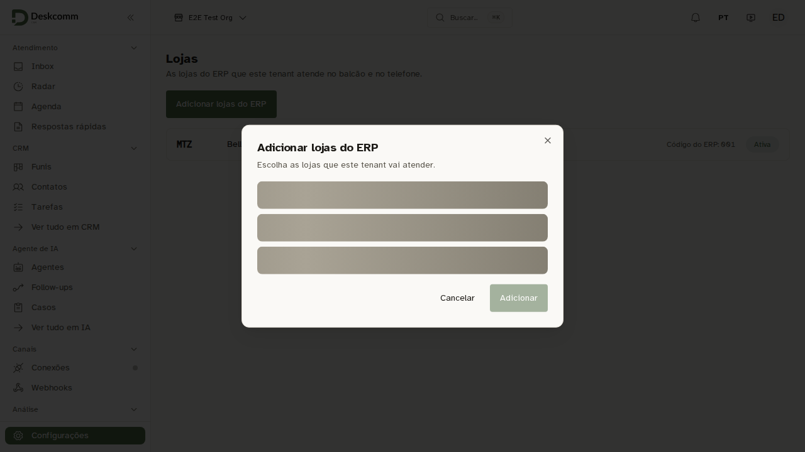
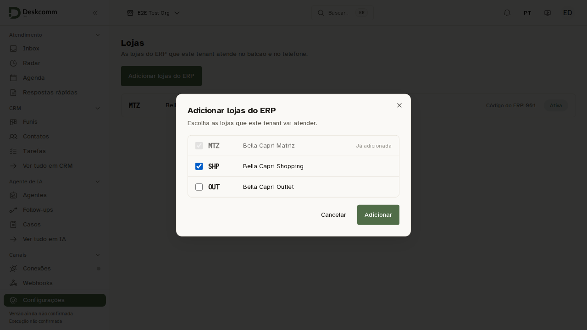
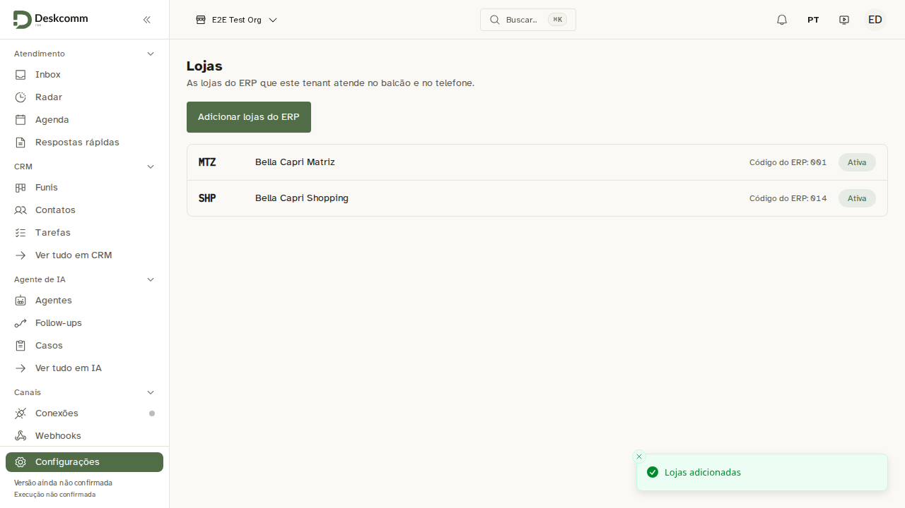
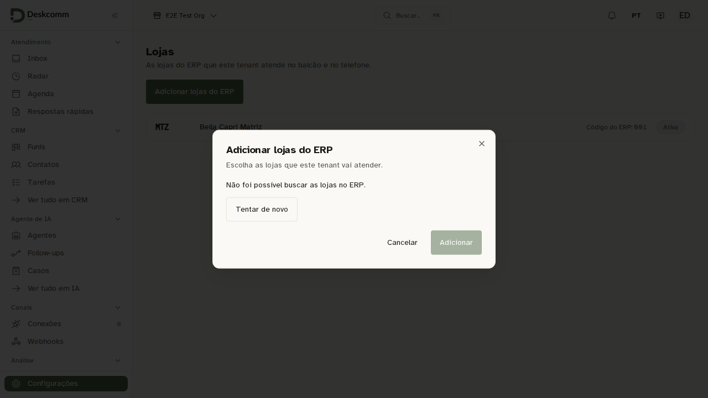
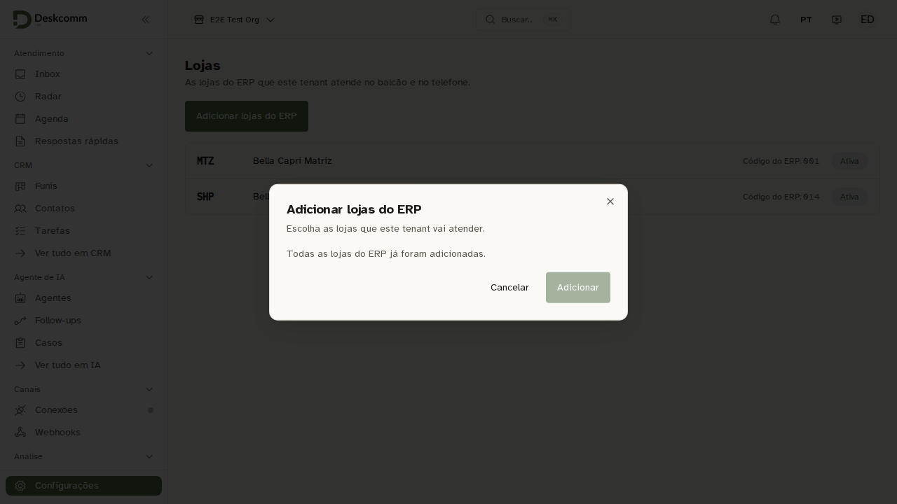
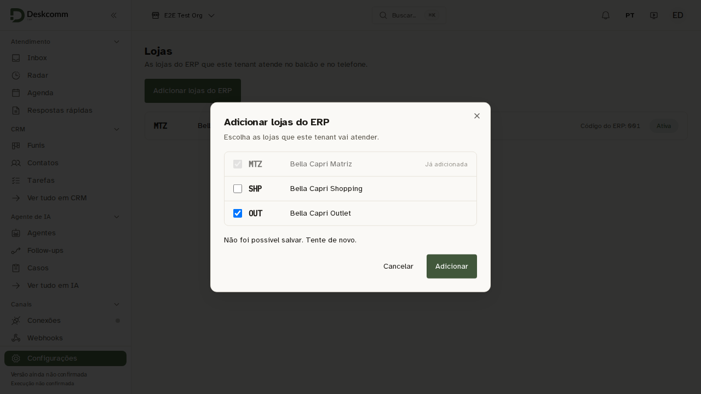

# US-008 - Aba Lojas: adicionar lojas do ERP

Prova pela tela de `tests/e2e/pdv-aba-lojas-adicionar.spec.ts` (build de produção, banco fresco do `baseline.sql`, módulo `pdv` instalado pelo dono, rotas `/api/v1/pdv/*` interceptadas). Alturas dos alvos medidas com `getBoundingClientRect`: 44 px ou mais.

Carregando (esqueleto no modal):

Escolha (as já adicionadas marcadas e desabilitadas):

Sucesso (modal fechado, lista atualizada, aviso "Lojas adicionadas"):

Erro do ERP com "Tentar de novo":

Nenhuma loja nova disponível:

Falha ao salvar (seleção mantida):

