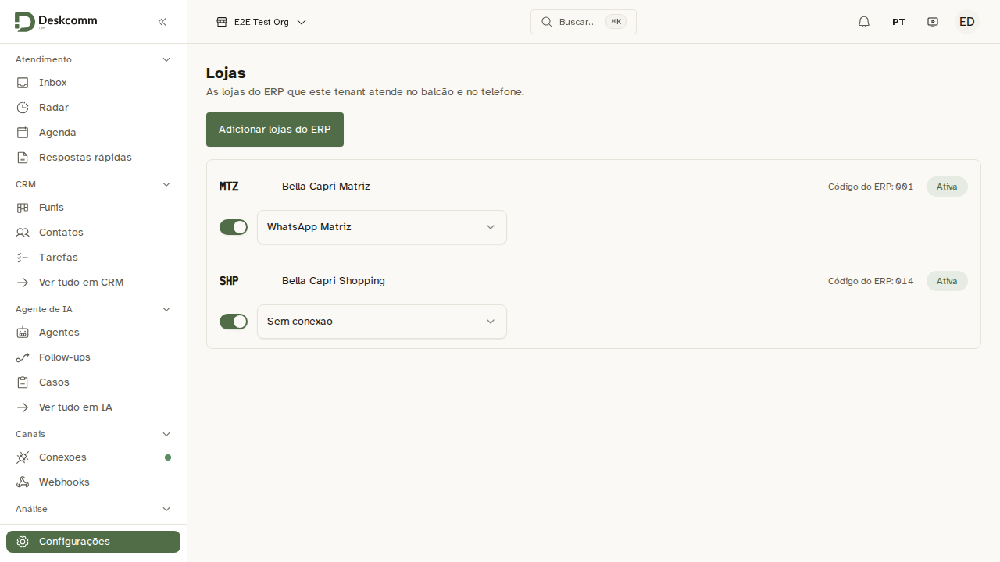
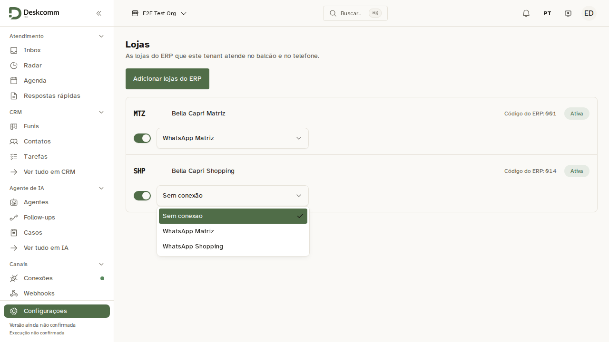
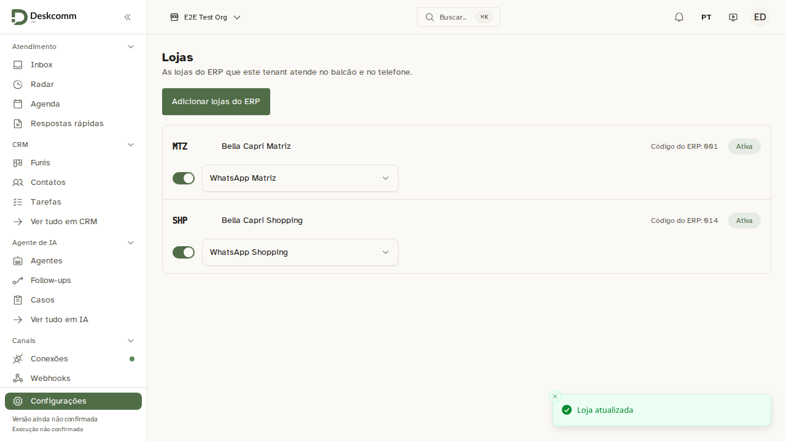
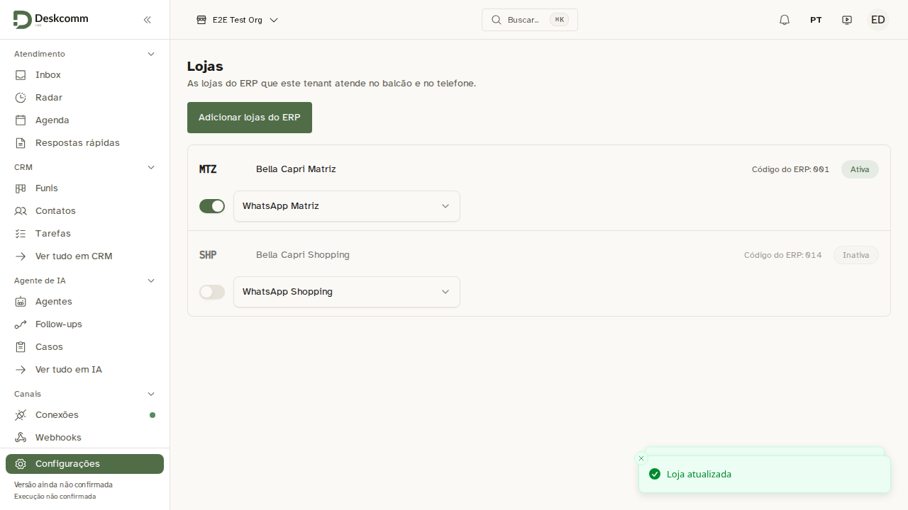
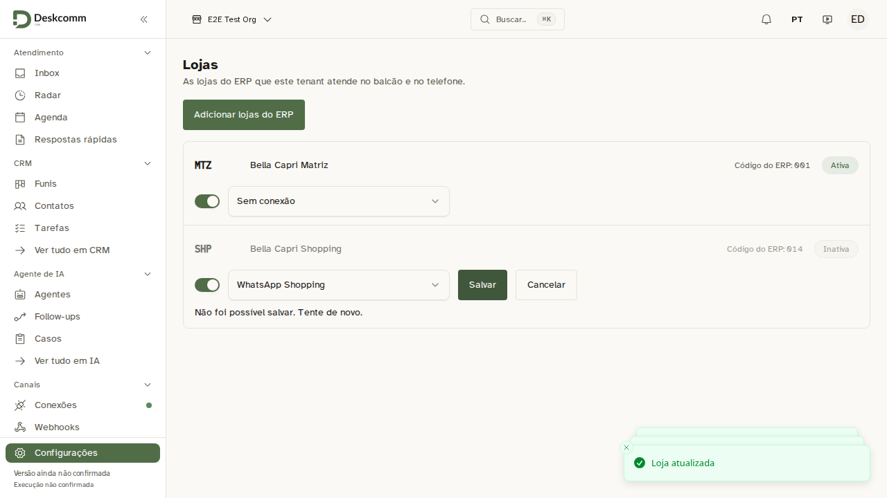

# US-009 - Aba Lojas: ativar, desativar e vincular conexão

Prova pela tela de `tests/e2e/pdv-aba-lojas-editar.spec.ts` (build de produção, banco fresco do `baseline.sql`, módulo `pdv` instalado pelo dono, rotas `/api/v1/pdv/*` e `/api/v1/channel-sessions` interceptadas). Alturas dos alvos (seletor e Salvar) medidas com `getBoundingClientRect`: 44 px ou mais.

Lista com os controles:

Opções do seletor, com "Sem conexão":

Conexão vinculada (aviso "Loja atualizada", lista atualizada sem recarregar):

Loja inativa esmaecida e identificada:

Falha ao salvar (alteração mantida na tela, com a mensagem):

