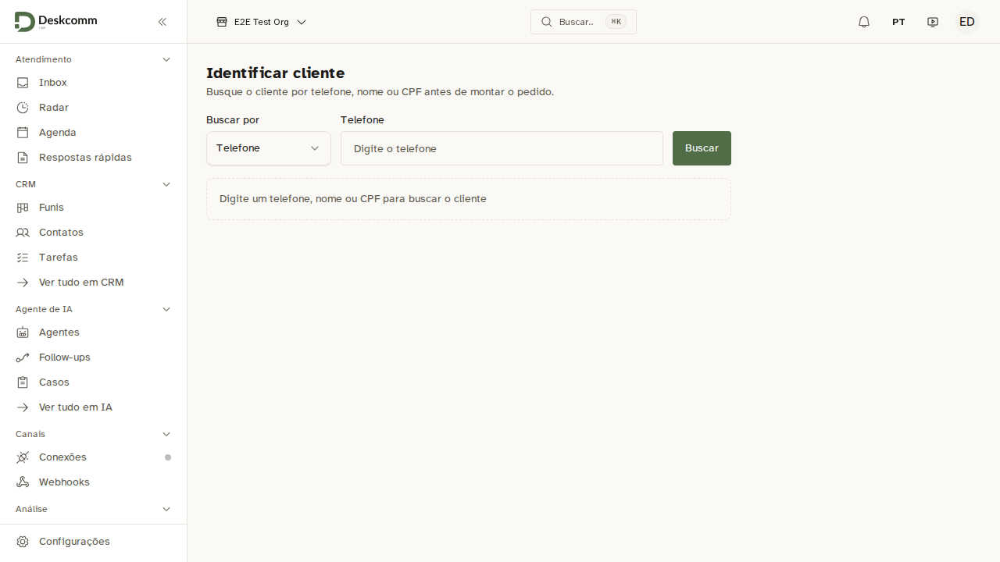
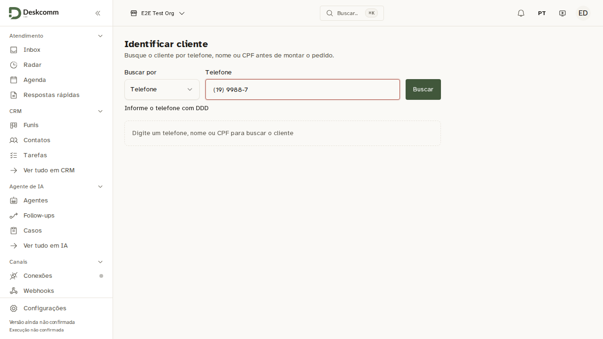
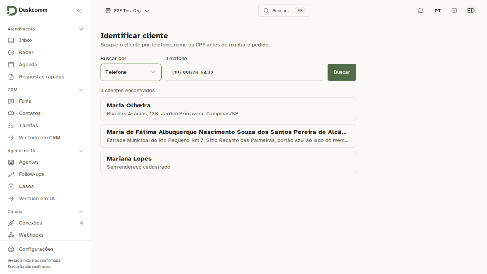
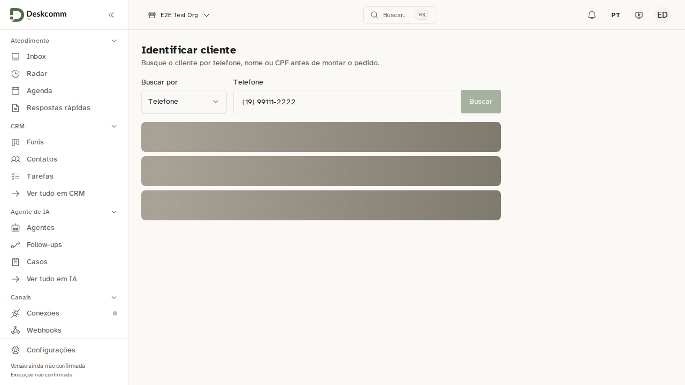
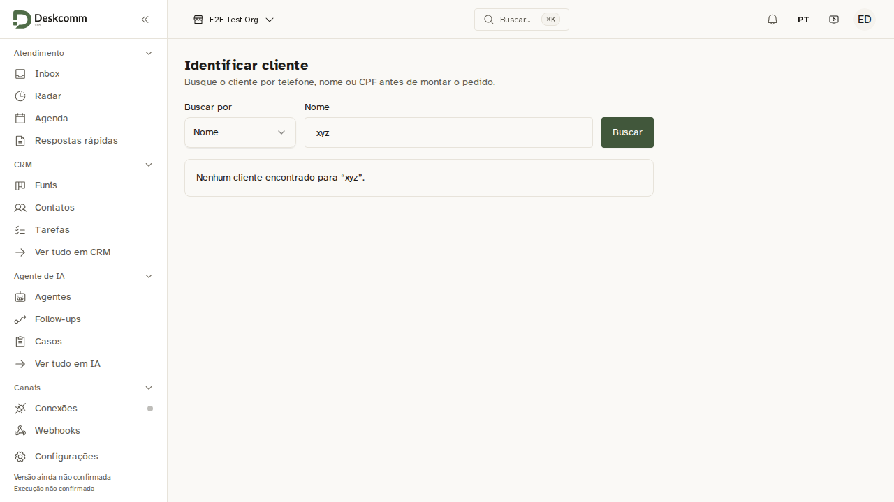
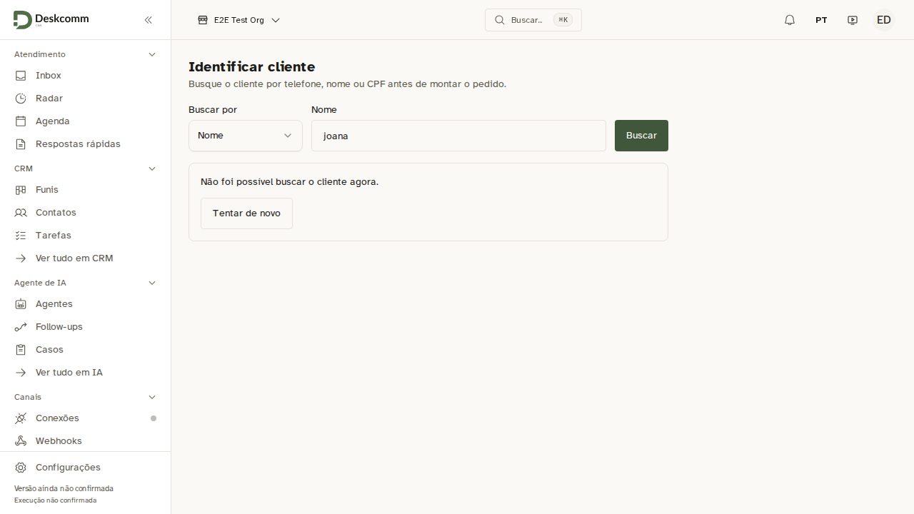

# US-011 - Tela de identificação do cliente: busca e lista de candidatos

Prova pela tela de `tests/e2e/pdv-identificar-cliente.spec.ts` (build de produção, banco fresco do `baseline.sql`, módulo `pdv` instalado pelo dono, rota `GET /api/v1/pdv/clientes` interceptada). Alvos (seletor, campo, Buscar, itens da lista, Tentar de novo) medidos com `getBoundingClientRect`: 44 px ou mais; texto longo cortado com reticências sem estourar a página; CPF/telefone digitados fora da URL e do `localStorage`/`sessionStorage`.

Antes da primeira busca:

Telefone incompleto ("Informe o telefone com DDD"):

Lista de candidatos, com máscara de telefone e texto longo cortado:

Carregando (esqueleto, Buscar desabilitado):

Nenhum cliente encontrado:

Erro com "Tentar de novo":

