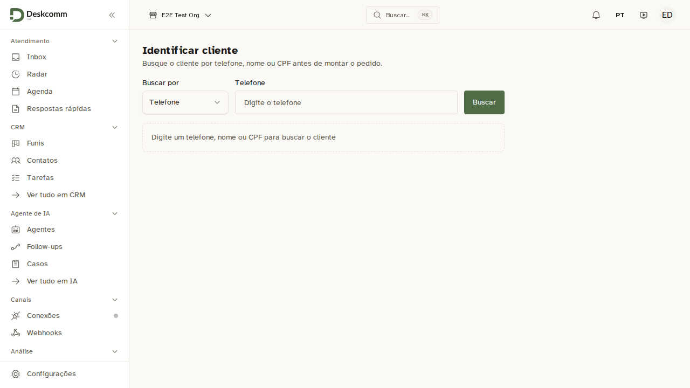
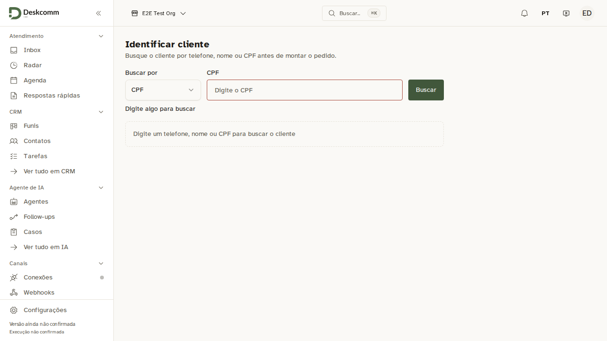
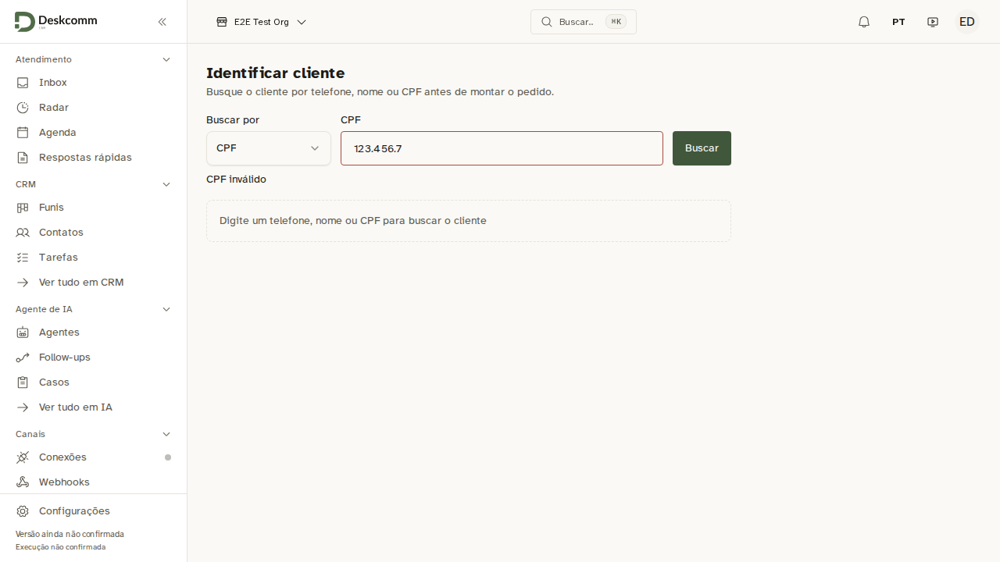
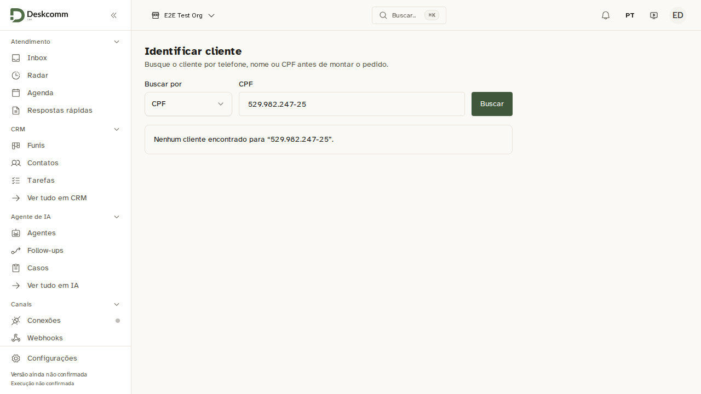
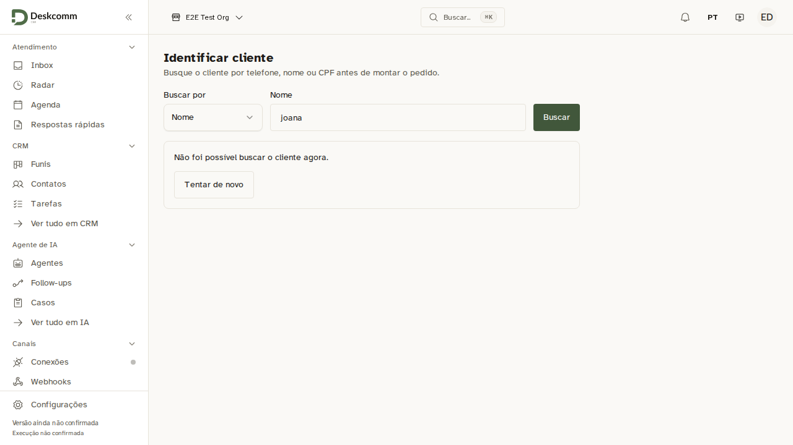
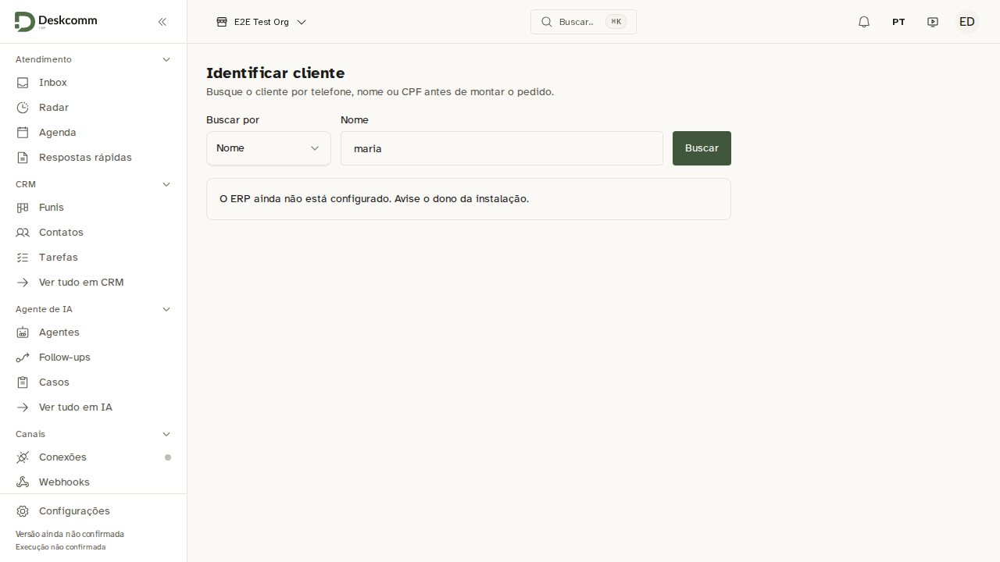
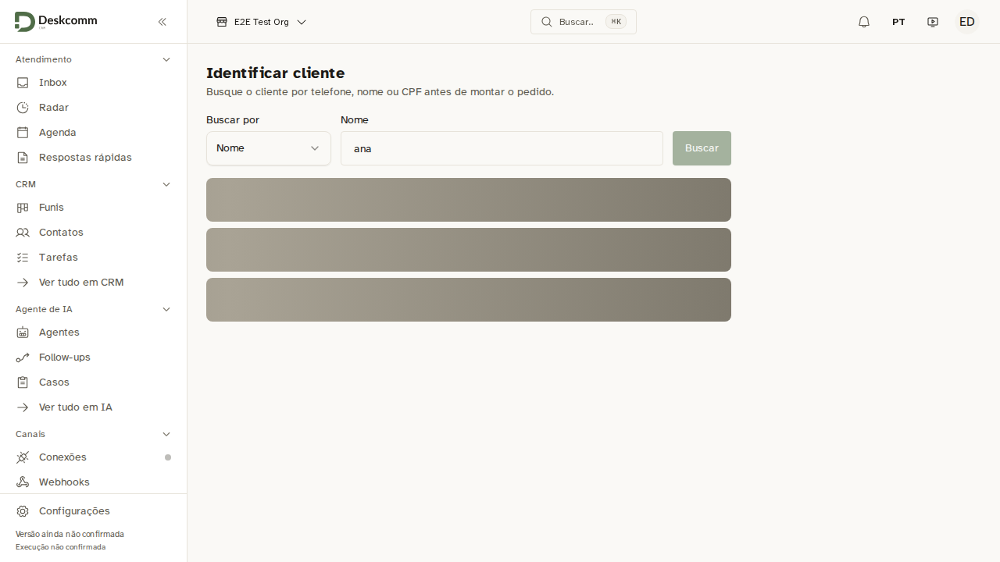

# US-012 - Tela de identificação do cliente: estados e erros

Prova pela tela de `tests/e2e/pdv-identificar-cliente-estados.spec.ts` (build de produção, banco fresco do `baseline.sql`, módulo `pdv` instalado pelo dono, rota `GET /api/v1/pdv/clientes` interceptada: nada fala com o ERP). A spec afirma os textos exatos, que a busca inválida não chama a rota, que o termo continua no campo, que "Tentar de novo" repete a mesma busca (duas falhas seguidas e depois a lista), que não existe "cadastrar" com o ERP fora (ADR-002), que "ERP não configurado" não vaza endereço nem chave e que o botão "Tentar de novo" tem 44 px ou mais (`getBoundingClientRect`).

Antes da primeira busca:

Campo vazio ("Digite algo para buscar"):

CPF com dígito verificador errado ("CPF inválido"):

Nenhum resultado, com o termo mantido no campo:

ERP fora do ar, com "Tentar de novo":

ERP não configurado (orientação, sem endereço nem chave):

Carregando (esqueleto e "Buscar" desabilitado):

