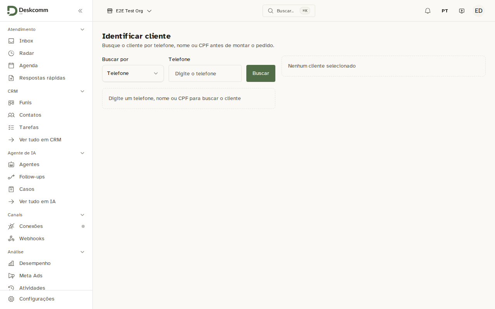
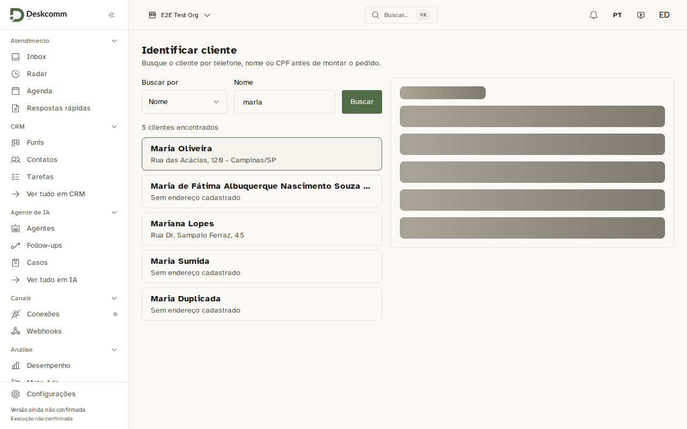
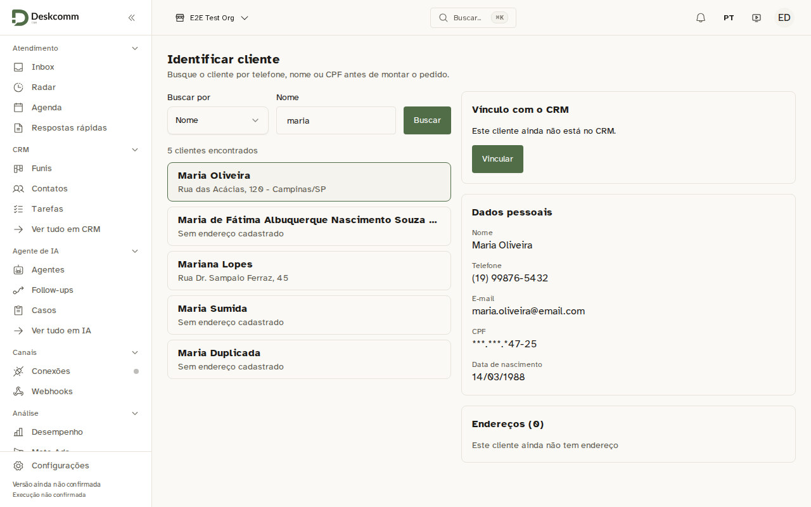
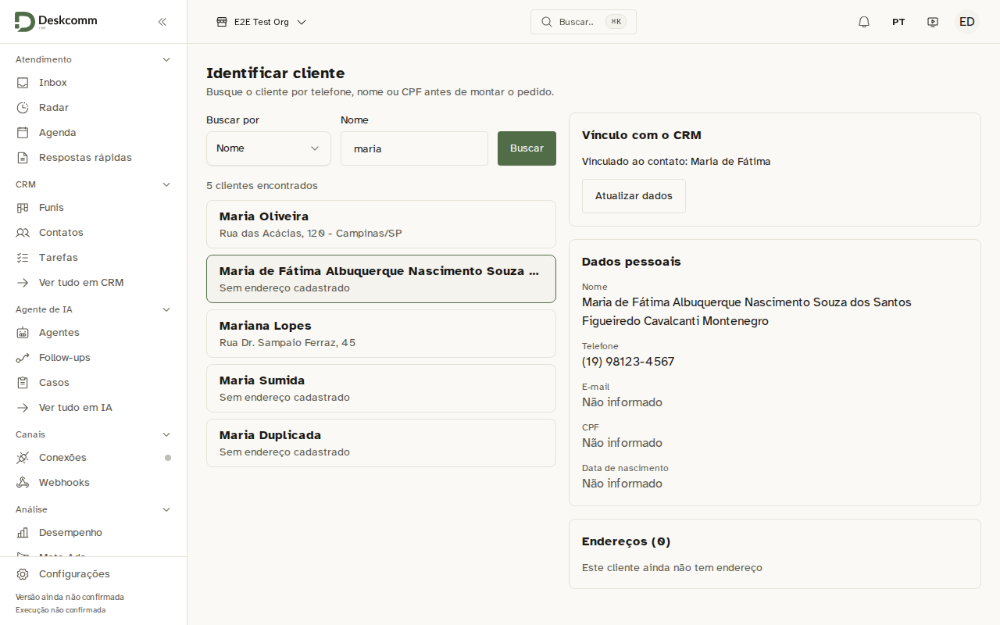
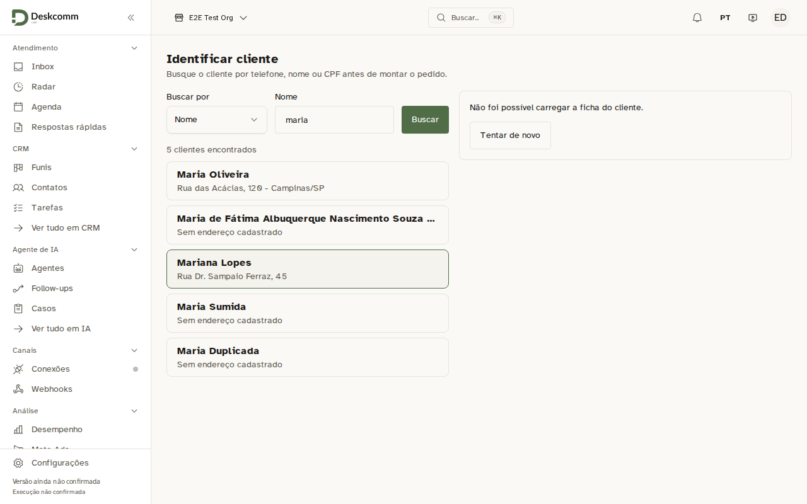
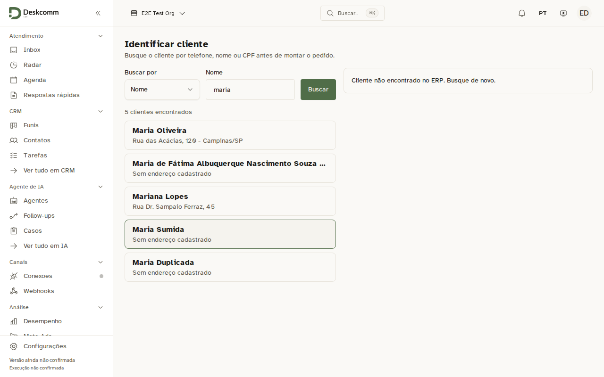
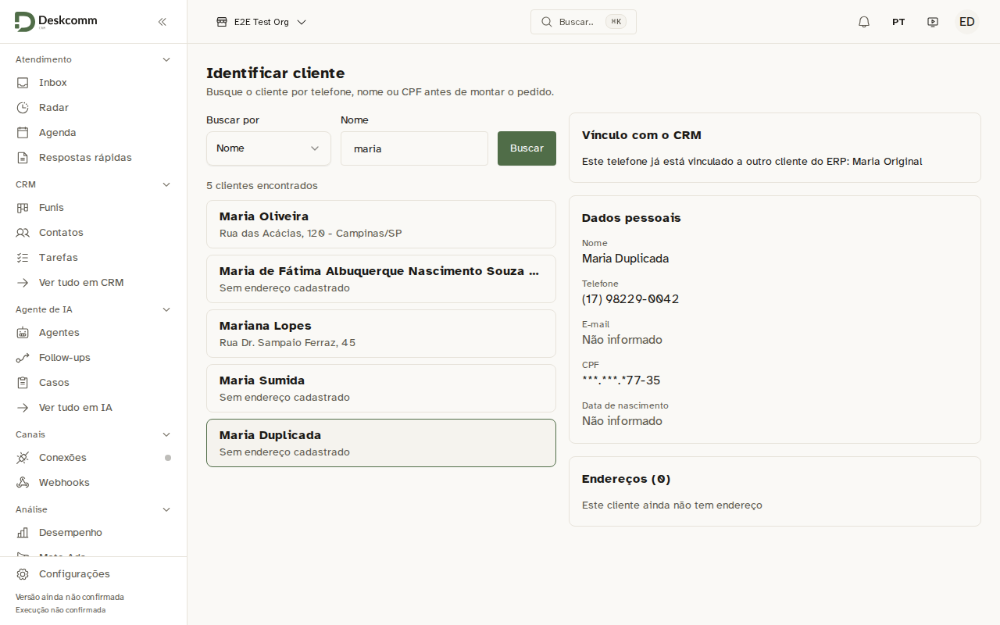
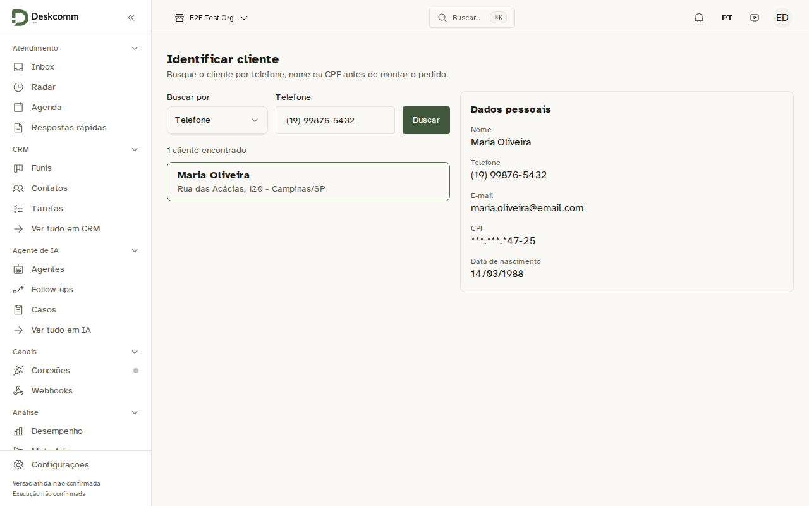

# US-016 - Ficha do cliente: dados pessoais

Prova pela tela de `tests/e2e/pdv-ficha-cliente-dados.spec.ts` (build de produção, banco fresco do `baseline.sql`, módulo `pdv` instalado pelo dono, rotas `/api/v1/pdv/*` interceptadas: nada fala com o ERP). A spec afirma: a ficha abre ao escolher um candidato ou com resultado único; nome, telefone, e-mail, CPF mascarado (`***.***.*47-25`) e nascimento em dd/mm/aaaa; "Não informado" para campo ausente; nenhum botão dentro da ficha e nenhum "editar/adicionar/remover/selecionar cliente"; CPF e nascimento fora da URL e do `localStorage`/`sessionStorage`; nome longo sem rolagem horizontal e sem vazar da ficha; candidatos e "Tentar de novo" com 44 px ou mais (`getBoundingClientRect`).

Nenhum cliente selecionado:

Carregando (esqueleto):

Ficha completa:

Nome longo e campos ausentes ("Não informado"):

Erro ao carregar, com "Tentar de novo":

Cliente não encontrado (404 do ERP):

Telefone já vinculado a outro cliente do ERP (ADR-007; abrir a ficha não escreve, e este caso não tem botão):

Resultado único por telefone abre a ficha direto:

