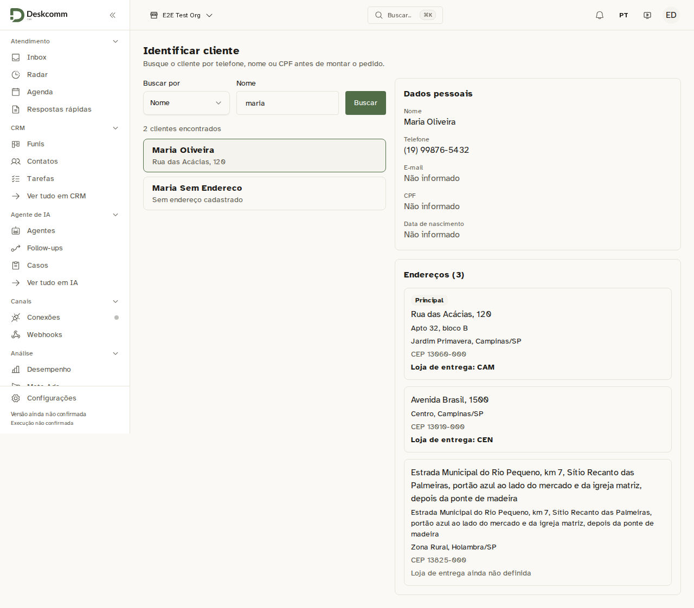
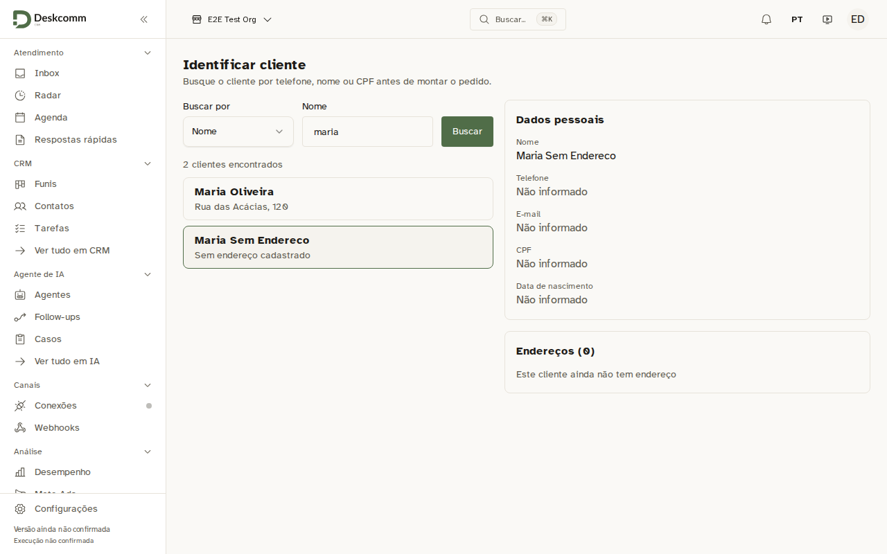

# US-017 - Ficha do cliente: endereços

Prova pela tela de `tests/e2e/pdv-ficha-cliente-enderecos.spec.ts` (build de produção, banco fresco do `baseline.sql`, módulo `pdv` instalado pelo dono, rotas `/api/v1/pdv/*` interceptadas: nada fala com o ERP). A spec afirma: título "Endereços (3)" abaixo de "Dados pessoais" (`getBoundingClientRect`), um card por endereço com selo "Principal" só no principal, endereço, complemento (omitido quando ausente), bairro/cidade/UF, CEP formatado e "Loja de entrega: <sigla>" ou "Loja de entrega ainda não definida"; endereço e complemento muito longos sem rolagem horizontal e dentro do card; nenhum botão no bloco nem ação de alterar, remover, tornar principal ou adicionar; cliente sem endereço mostra "Este cliente ainda não tem endereço".

Três endereços (principal, sem complemento, sem loja e com texto longo):

Cliente sem endereço:

