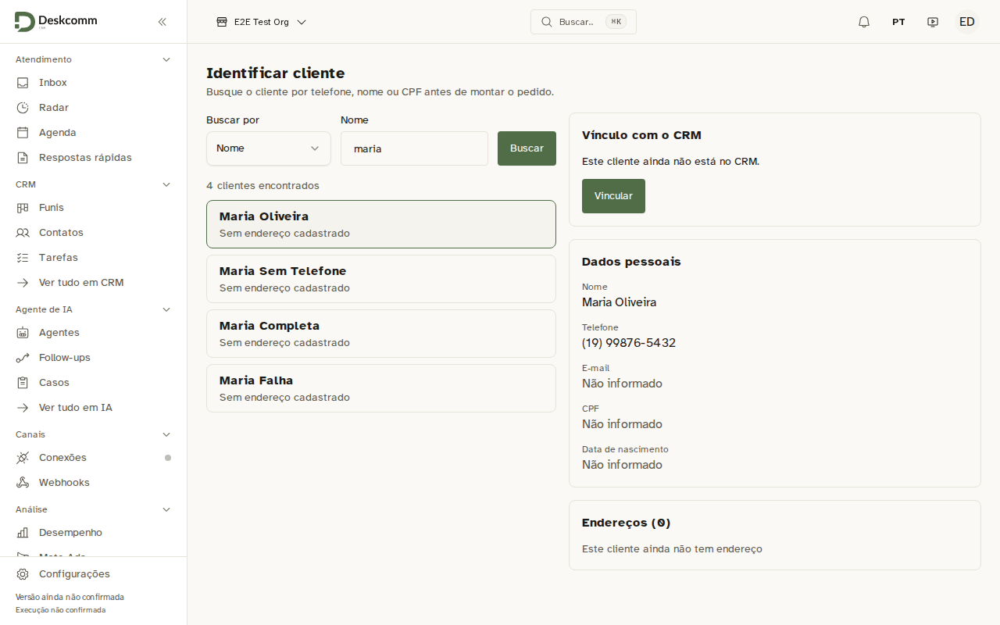
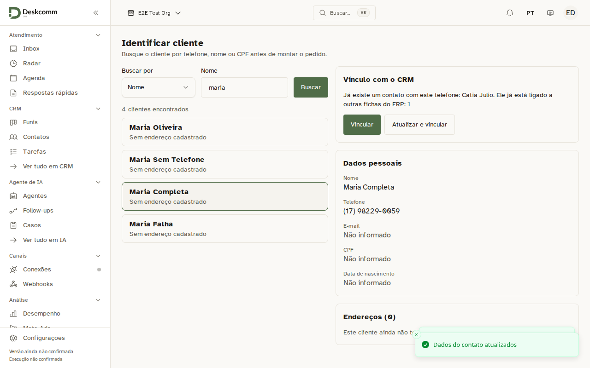
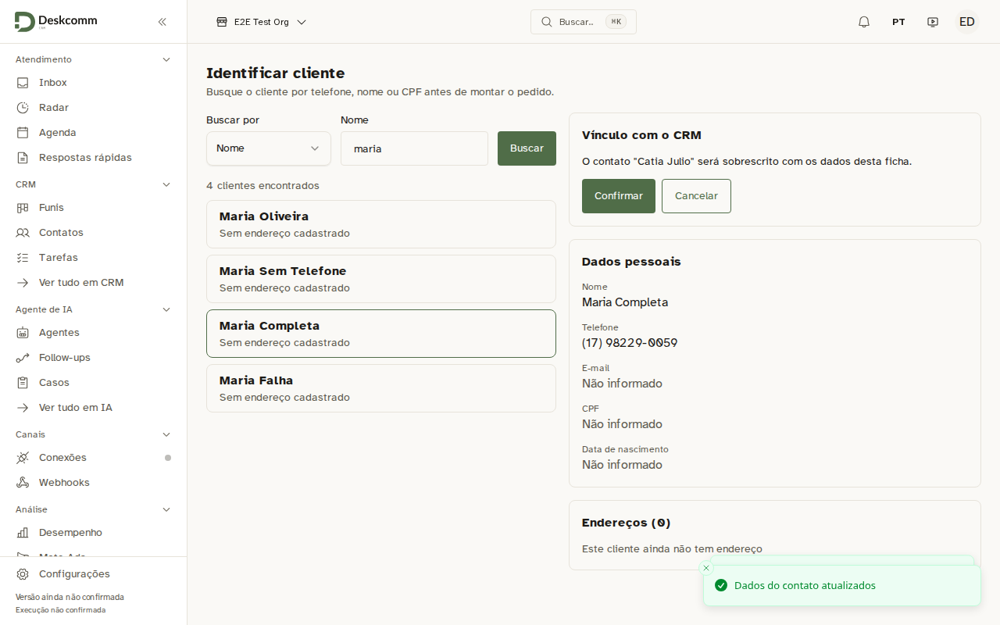
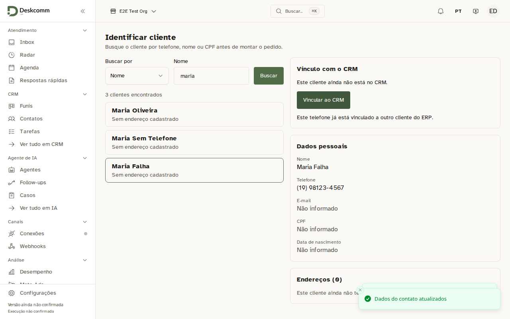

# Evidência: vínculo do cliente com o contato do CRM por botão (ADR-007 e ADR-008)

Spec: `tests/e2e/pdv-ficha-cliente-vinculo.spec.ts`, com `/api/v1/pdv/*` interceptada (nada fala com o ERP) e dados fictícios.

Cliente sem contato no telefone. Abrir a ficha não escreveu nada; só o botão Vincular aparece:

Depois do clique em "Vincular" (um POST), a ficha mostra o contato e o botão "Atualizar dados":

Cliente sem telefone no ERP: sem botão, com o motivo:

O telefone já tem um contato ligado a outra ficha do ERP: os dois botões e o aviso das outras fichas:

"Atualizar e vincular" pede confirmação citando o contato que será sobrescrito:

A API recusa o vínculo (mais de um contato no número): a mensagem orienta e os botões continuam:

