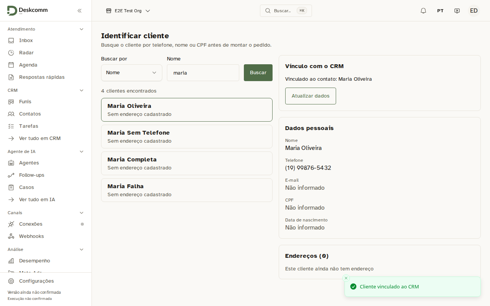
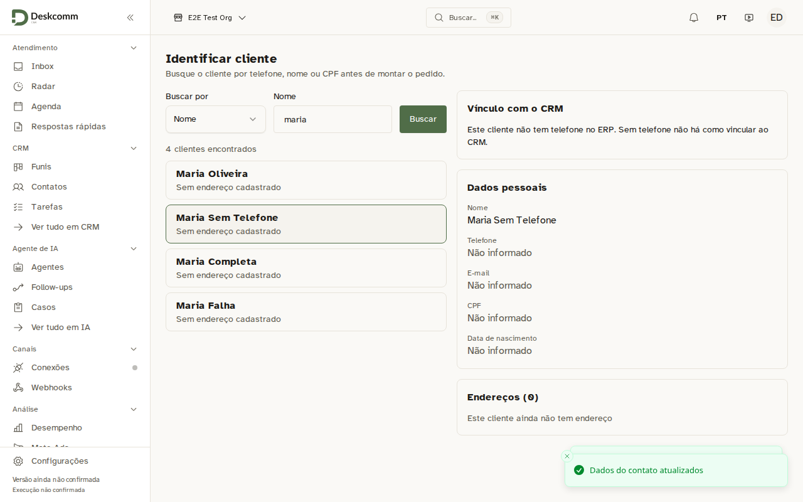

# Evidência: vínculo do cliente com o contato do CRM por botão (ADR-007)

Spec: `tests/e2e/pdv-ficha-cliente-vinculo.spec.ts`, com `/api/v1/pdv/*` interceptada (nada fala com o ERP) e dados fictícios.

Cliente que ainda não está no CRM. Abrir a ficha não escreveu nada; o botão aparece:

Depois do clique em "Vincular ao CRM" (um POST), a ficha mostra o contato e o botão "Atualizar dados":

Cliente sem telefone no ERP: sem botão, com o motivo:

A API recusa o vínculo (o telefone já é de outro cliente do ERP): a mensagem orienta e o botão continua:

